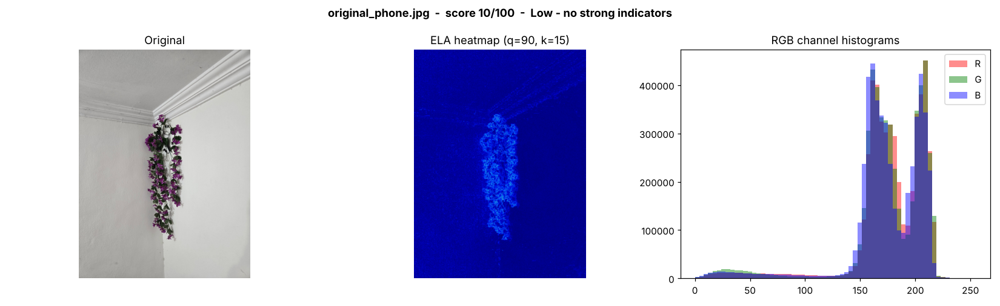
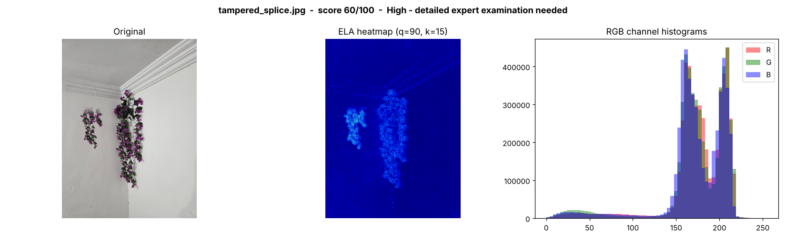

# Image Tampering Detector using ELA & Metadata Inspection

CSDF mini-project — Shreyash Pawar (BECOC80), Krutika Yadav (BECOC77).

A Python tool that screens an image for signs of tampering by combining **Error Level Analysis (ELA)**,
**EXIF metadata checks**, **SHA-256 integrity hashing** and a **block-wise RGB analysis**, and turns the
evidence into a 0–100 suspicion score.

> **Results are screening indicators, not proof.** A high score means "examine this image more closely",
> never "this image is forged". A low score does not prove authenticity.

## Quick start

```bash
pip install -r requirements.txt

python make_demo_images.py                    # derives the edited test images from samples/original_phone.jpg
python image_tampering_detector.py samples    # analyse the folder
python image_tampering_detector.py a.jpg b.jpg -o results
```

Output goes to `tamper_report/` (or `-o`): `tampering_report.txt`, `tampering_report.csv`, and per image
`<name>_ela.png` (amplified ELA) and `<name>_analysis.png` (original | ELA heatmap | RGB histograms).
Input files are only ever opened read-only.

### Integrity check with trusted hashes

```bash
python image_tampering_detector.py evidence/ --save-baseline baseline.csv   # at acquisition
python image_tampering_detector.py evidence/ --reference baseline.csv       # later: MATCH / MISMATCH
```

A hash computed for the first time proves nothing; it only detects change relative to a trusted earlier value.

### Google Colab

```python
!pip install -q opencv-python-headless
from google.colab import files; files.upload()          # choose your images
!python image_tampering_detector.py . -o results
```

## Test images

| File | What it is |
|---|---|
| `samples/original_phone.jpg` | **Real photograph** taken on a phone and copied to the laptop by USB cable. Never re-saved by the project. |
| `samples/tampered_splice.jpg` | Copy-move edit of the original: a flower cluster is cloned onto the empty left wall (scaled, brightened, feathered), re-saved at JPEG quality 95 with an editor tag. |
| `samples/tampered_no_exif.jpg` | The same edit with all metadata stripped (an attacker hiding the editor). |
| `samples/original_phone_lossless.png` | The original converted to PNG — a non-JPEG input, where ELA is not scored. |

The edit itself is a real pixel-level modification, but it was made by `make_demo_images.py`, and the
`Software: Adobe Photoshop 25.0` tag is written by the script to emulate an edited file. For stronger evidence,
add your own hand-edited copies to `samples/` and re-run.

## Results and analysis

Run on the four test images (`sample_output/`, full numbers in `tampering_report.csv`):

| Image | ELA mean | Outlier-block cluster* | Anomalous RGB blocks | Metadata flags | Score | Review level |
|---|---|---|---|---|---|---|
| `original_phone.jpg` | 6.86 | 0.02 % | 228 / 4800 (4.8 %) | no EXIF | **10** | Low |
| `original_phone_lossless.png` | 6.86 | 0.02 % | 228 / 4800 (4.8 %) | none (PNG) | **0** | Low |
| `tampered_no_exif.jpg` | 7.09 | 0.31 % | 298 / 4800 (6.2 %) | no EXIF | **50** | Medium |
| `tampered_splice.jpg` | 7.10 | 0.31 % | 296 / 4800 (6.2 %) | editor tag | **60** | High |

\* largest connected cluster of blocks whose ELA is unusually high for their texture, as a share of all blocks.





**What the analysis shows**

- **Original photo.** The ELA heatmap is uniformly dark; the only brighter area is the flowers themselves, which is
  expected because fine detail always produces more ELA error than a plain wall. Score 10 comes only from the
  missing-EXIF indicator (see the note below).
- **Spliced photo.** The cloned flowers on the left glow clearly brighter than the genuine flowers on the right, even though
  both are the same kind of texture. The edit changed the cloned pixels' compression history (resampling, brightness
  change, re-save), and ELA exposes that difference. Together with the editor tag this gives 60 / High.
- **Metadata stripped.** The pixel evidence is identical, but the editor tag is gone, so the score falls from 60 to 50.
  This is the point of combining indicators: removing metadata hides one clue but not the ELA evidence.
- **PNG.** ELA is not scored for non-JPEG files, so the lossless copy scores 0. Absence of evidence here
  is a limitation of the method, not a clean bill of health.
- **Raw ELA alone would have misled.** On the first real photo the original version of the detector rated the untouched
  image 65 / High, because it compared every block with the whole-image median and the flowers are textured everywhere.
  This was fixed by normalising each block's ELA by its own texture (see Design notes).

### Honest caveats about this evaluation

- The test set is **one real photo plus three derived files**. It demonstrates the pipeline and the behaviour above; it is
  **not** a measurement of real-world accuracy.
- Thresholds were adjusted after seeing this photo (texture-normalised ELA cluster threshold 0.002, RGB block threshold
  0.03 → 0.08). With so few images these values may be over-fitted. Re-tune on a larger labelled set before trusting them.
- The RGB block-wise check flagged ~5 % of blocks in the **untouched** original (flowers vs. plain wall), so it was
  too weak to separate originals from edits on this data and its threshold was loosened. It acts only as a weak supporting indicator.
- The missing-EXIF point on `original_phone.jpg` appears because the copy used here carries no EXIF block. **Use the file
  exactly as it comes off the phone** (cable copy, not WhatsApp / chat upload / screenshot, which strip metadata);
  with intact camera EXIF this indicator does not fire and the original scores 0.

## How it maps to the report

| Report section | Where in the code |
|---|---|
| 3.3 Basic image analysis | `basic_properties()` |
| 3.4 Hash generation (SHA-256, optional MD5/SHA-1) | `compute_hashes()` |
| 3.5 EXIF inspection (editor tag, missing EXIF, time mismatch) | `read_exif()`, `metadata_checks()` |
| 3.6 ELA: `ELA = k·\|I − I_q\|` | `run_ela()` |
| 3.7 RGB channel + block-wise analysis | `channel_analysis()` |
| 3.8 Suspicion scoring (weights 40/20/15/10/15; levels 0–29 / 30–59 / 60–100) | `Config`, `score_image()` |
| Reference-hash comparison | `load_reference_hashes()`, `integrity_status()` |
| Report generation (text/CSV + ELA images) | `format_text_report()`, `write_csv()` |

All weights, thresholds, the ELA quality (90) and amplification (k = 15) are constants in the `Config` dataclass
at the top of the script.

## Design notes

- **ELA indicator** fires if the mean error, the high-error pixel ratio, *or* a cluster of blocks with outlier
  error exceeds its threshold. For the cluster test, each 32×32 block's mean ELA is divided by its texture strength
  (mean Sobel gradient) and compared, as a robust z-score of the log-ratio, with other *textured* blocks only, so detailed
  objects are not flagged merely for being detailed. ELA is computed for every format but only **scored for JPEG**.
- **Block-wise check** compares colour balance (R−G, B−G) and a robust noise estimate per 32×32 block with the image's
  own median (robust z-score). It is a weak supporting indicator.
- **Missing EXIF** only counts for JPEGs treated as camera photos (default); use `--no-camera-claim` to disable.

## Known limitations (report Section 6.2)

Resizing, repeated saving and social-media compression distort ELA; metadata can be edited or stripped; no
AI-generated-image detection; copy-move is detected only indirectly (through compression-history differences,
not by matching duplicated regions); weights need tuning on a labelled set.

## Repository layout

```
image_tampering_detector.py   main tool
make_demo_images.py           builds the edited test images from samples/original_phone.jpg
requirements.txt
samples/                      real photo + derived test images
sample_output/                reports, ELA images and figures from running the tool on samples/
```
